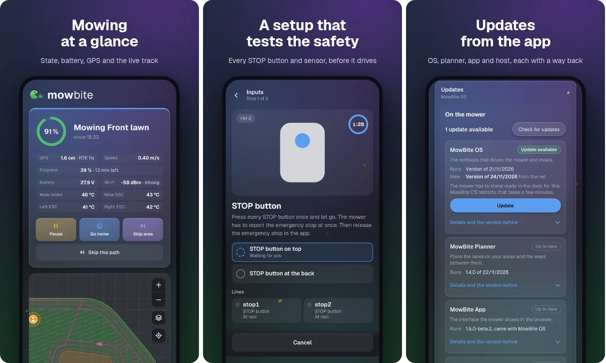
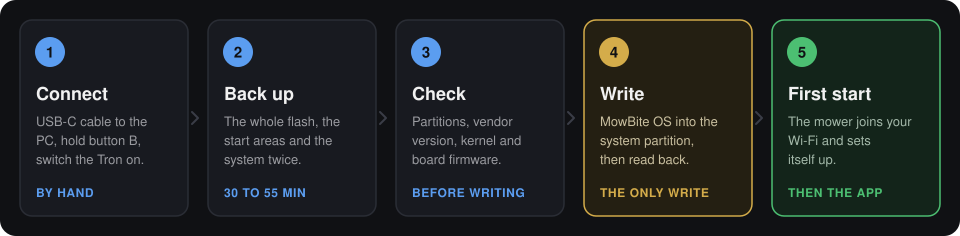
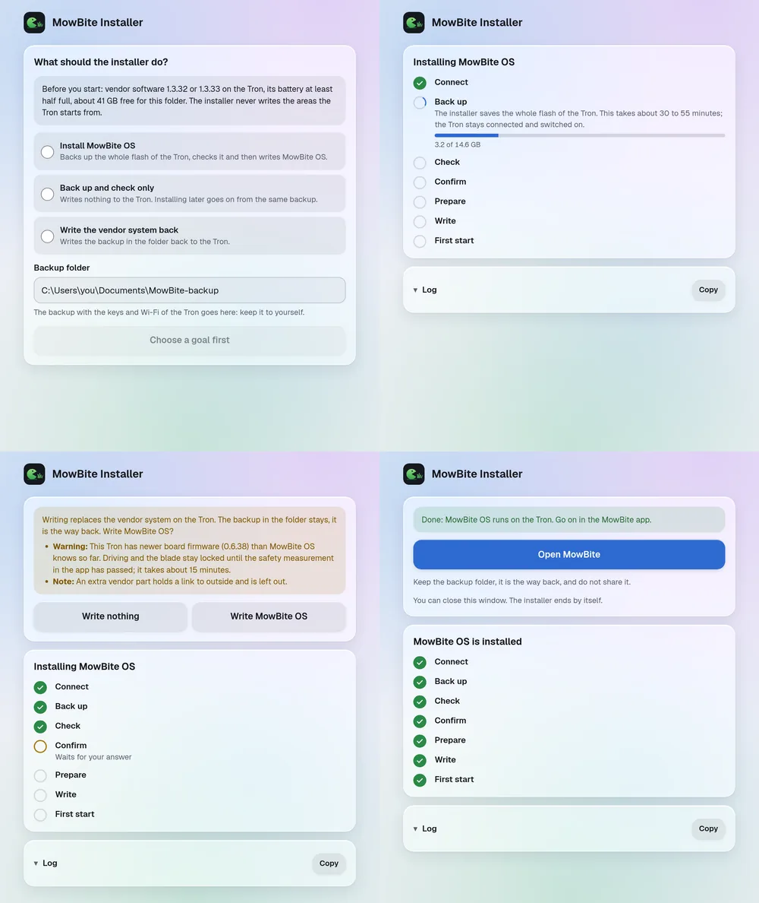
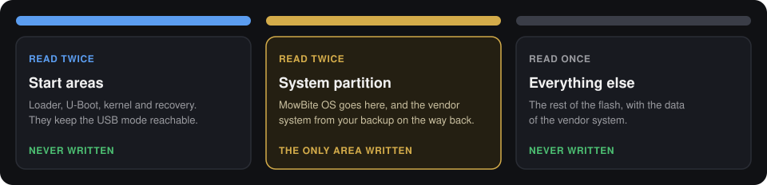

<p align="center">
  
</p>

<h1 align="center">MowBite OS installer</h1>

<p align="center">
  Puts MowBite OS on an Airseekers Tron from a Windows or Linux PC over a USB cable.<br>
  With a full backup first, and a way back to the vendor system.
</p>

<p align="center">
  
  
  <a href="https://github.com/mkaaaaaay/mowbite-installer/releases"></a>
  <a href="LICENSE"></a>
  <a href="https://discord.gg/VpPFRx9Ce4"></a>
</p>

<p align="center">
  <a href="#get-started"><b>Get started</b></a> ·
  <a href="#what-you-need"><b>What you need</b></a> ·
  <a href="#safety-and-your-data"><b>Safety</b></a> ·
  <a href="#back-to-the-vendor-system"><b>The way back</b></a> ·
  <a href="https://discord.gg/VpPFRx9Ce4"><b>Discord</b></a>
</p>



<p align="center">
  <a href="https://youtu.be/nUGaw1tlYOk"></a><br>
  <sub>MowBite in 83 seconds, on YouTube</sub>
</p>

The installer puts [MowBite OS](https://github.com/mkaaaaaay/mowbite-os) on an Airseekers Tron and takes it back to
the vendor system whenever you want. Before it writes anything it reads a full backup of the mower's flash, and that
backup is what the way back uses.

After the installation the mower runs the [MowBite app](https://github.com/mkaaaaaay/mowbite): open it in the browser
on a phone or computer, or use the Android app. The mower works on its own in your home network, without a cloud and
without an account.

> [!WARNING]
> **Test version.** The installer is at an early stage and things still change. Use it only if you are fine with a
> test, and keep the backup it makes. The way back to the vendor system uses it.

The MowBite OS installer is a community project and not affiliated with Airseekers. Questions, test reports and news:
the [MowBite Discord](https://discord.gg/VpPFRx9Ce4).

## Contents

- [What it does](#what-it-does)
- [What you need](#what-you-need)
- [Get started](#get-started)
- [Safety and your data](#safety-and-your-data)
- [Back to the vendor system](#back-to-the-vendor-system)
- [The MowBite project](#the-mowbite-project)
- [Build](#build)
- [License](#license)

## What it does

| | |
| --- | --- |
| **Backup first** | Reads the whole flash of the mower before anything else. The system and every area the mower starts from are read a second time and compared by sha256. |
| **Checks before writing** | Partition table, vendor version, kernel, the parts MowBite OS needs from the vendor system and the firmware of the boards. A check that fails ends the run before the first write. |
| **One write** | MowBite OS goes into the system partition only. It is read back and compared before the mower restarts. The boot area is never written. |
| **Signed files** | Downloads the newest release from [mowbite-releases](https://github.com/mkaaaaaay/mowbite-releases) and checks every file against keys built into the installer. |
| **First start without the internet** | The mower joins your Wi-Fi and installs the OS, the planner and the app from what the installer gave it. |
| **A dry run** | Back up and check only (`check`) makes the backup and runs every check, then ends without writing anything to the mower. |
| **Goes on after a stop** | Start it again with the same folders and it goes on where it was. A backup that was started is resumed, never replaced. |
| **The way back** | `back` writes the vendor system from your backup, after checking that the backup belongs to this mower. |
| **In the browser** | Started without arguments it shows its steps on a page in your browser. Commands in a terminal work as well. |

## What you need

- A PC with Windows 10 or 11 (x64) or Linux (x86_64), with internet for the download.
- The Tron on vendor software 1.3.32 or 1.3.33. The installer checks it before writing.
- Free space: about 25 GB for the backup and 16 GB for work files. Both can be on an external disk.
- A USB-C data cable.
- The Tron with its battery at least half full, off its charging station.
- The name and key of your Wi-Fi.
- On Linux, access to the Tron on USB without root, for example with this udev rule in
  `/etc/udev/rules.d/70-mowbite-tron.rules`:

  ```
  SUBSYSTEM=="usb", ATTR{idVendor}=="2207", ATTR{idProduct}=="350b", MODE="0660", TAG+="uaccess"
  ```

## Get started





1. **Download** the installer for your PC from the
   [releases](https://github.com/mkaaaaaay/mowbite-installer/releases) of this repo.
   On Windows keep `mowbite-usb-driver.exe` and `libwdi.dll` next to `mowbite-installer.exe`.
2. **Start it** without arguments. It opens its page in your browser, in English or German as your browser is set.
   The page runs on your own PC only and ends with the installer.
3. **Choose what it should do** and the backup folder: install MowBite OS, back up and check only (writes nothing to
   the mower, installing later goes on from the same backup), or write the vendor system back. For an installation
   it also asks for the name and key of your Wi-Fi: the key goes only to the mower.
4. **Connect the Tron** when the page asks for it.
   1. Battery in, Tron off and not on its charging station.
   2. Take off the upper camera unit. A USB-C socket sits behind it.
   3. Connect the cable from this socket to the PC.
   4. Hold button B and switch the Tron on. Let go when the installer sees the Tron.
5. **Let it run.** From there it runs by itself and keeps the PC awake. Before it writes, the page shows what the
   checks found and asks you. The backup alone takes about 30 to 55 minutes, plan for one to two hours in all. If it
   stops, start it again with the same folder.
6. **Open the app** with the button at the end. Map, RTK and the safety measurement follow in the setup of the
   MowBite app. Until then the mower only takes remote control and the blade stays locked.

<details>
<summary><b>In a terminal instead</b></summary>

With a command the installer runs in text mode, with the same steps and questions:

```
mowbite-installer check <backup folder>
mowbite-installer install <backup folder> [--work <folder>]
mowbite-installer back <backup folder>
```

`check` makes the backup and runs every check, then ends. `install` with the same backup folder goes on from that
backup.

</details>

The installer downloads the release files into `<backup folder>/release`. To use files you already have, give their
folder after the backup folder in text mode.

On Windows the installer sets up the WinUSB driver once, if the Tron has none yet. Windows shows a prompt for
permission. The step uses [libwdi](https://github.com/pbatard/libwdi) like Zadig does.

<details>
<summary><b>What a run does, step by step</b></summary>

1. **Gets the release**: downloads the newest signed release from
   [mowbite-releases](https://github.com/mkaaaaaay/mowbite-releases) into the backup folder (about 220 MB), unless
   you give it a release folder. Then checks the PC: room for the backup and the work files.
2. **Finds the Tron** in its USB mode. On Windows it sets up the WinUSB driver once, if the Tron has none yet.
3. **Backs it up**: the whole flash once, the system and every boot area a second time, compared by sha256. A backup
   that was started is resumed, never replaced.
4. **Checks the mower** before anything is written: partition table, vendor version, kernel, the parts MowBite OS
   needs from the vendor system and the firmware the vendor system puts on the boards. An unknown vendor version or
   board firmware gets a clear warning first. Firmware older than MowBite OS knows stops the run, update the vendor
   system in the Airseekers app first.
5. **Writes MowBite OS** into the system partition only, reads it back and restarts the mower when both match. The
   boot area is never written.
6. **First start**: the mower joins your Wi-Fi and installs the OS, the planner and the app from what the installer
   gave it, without the internet. The installer finds it in your network and confirms the start. If the Wi-Fi does not
   work, the mower opens a setup Wi-Fi of its own. Its name and key are on a sheet in the backup folder.
7. **Hands over to the app**: map, RTK and the safety measurement follow in the setup of the MowBite app.

</details>

## Safety and your data



The installer never writes the areas the Tron starts from, so the USB mode it uses stays reachable. The backup holds
the start areas and the system area twice. The worst case is a system area written only in part, for example when the
cable comes off while writing: start the installer again with the same backup folder, it offers to write again or to
go back.

- **Keep the backup to yourself.** It holds the whole flash of your mower with its keys and your Wi-Fi. Do not share
  it, and keep it until you are sure you will not go back.
- The installer writes only into the system partition, and only after the backup and all checks passed. A check that
  fails ends the run before the first write.
- It never sends a drive or blade command. The new system starts with the hardware off until the setup in the app.
- Everything it installs is checked against keys built into the installer. Unsigned or changed files are refused.
- Nothing of the vendor is downloaded or shared: the parts the new system needs come from your own backup.
- The MQTT broker on the mower has no login. Keep the mower in a network you trust and never open its ports to the
  internet.

A robot mower has a turning blade and drives by itself. Read
[Safety](https://github.com/mkaaaaaay/mowbite-os#safety) of MowBite OS before the first drive.

## Back to the vendor system

Choose "Write the vendor system back" on the page, or in a terminal:

```
mowbite-installer back <backup folder>
```

It writes the system partition from your backup, after checking that the backup belongs to this mower. Connect
the Tron as for the installation. Writing the vendor system back has been tested on Linux. Should it fail on Windows,
write it back from a Linux PC.

## The MowBite project

- [MowBite](https://github.com/mkaaaaaay/mowbite): the app on the mower, with live dashboard, map editor, recording
  areas by driving, schedule and history. Also on
  [Google Play](https://play.google.com/store/apps/details?id=io.github.mkaaaaaay.mowbite).
- [MowBite OS](https://github.com/mkaaaaaay/mowbite-os): the software that runs the mower: positioning, mowing,
  docking and updates.
- [MowBite Planner](https://github.com/mkaaaaaay/mowbite-planner): the mowing planner, it keeps the whole mower away
  from edges and obstacles, not just its middle.
- [mowbite-releases](https://github.com/mkaaaaaay/mowbite-releases): the signed release files of MowBite OS this
  installer puts on the mower.
- [MowBite for Home Assistant](https://github.com/mkaaaaaay/mowbite-ha): Home Assistant integration for OpenMower
  mowers, with the MowBite card and map.
- [MowBite Updater](https://github.com/mkaaaaaay/mowbite-updater): keeps OpenMower, MowBite and the planner up to
  date on OpenMower mowers.
- [MowBite Discord](https://discord.gg/VpPFRx9Ce4): questions, test reports and news.

## Build

Rust 1.85 or newer:

```
cargo build --release
cargo test
```

The Windows helper for the USB driver is built by the GitHub workflow in
[build.yaml](.github/workflows/build.yaml) with MSYS2: libwdi as a DLL of its own and `windows/usb-driver.c`.

## License

Copyright 2026 mkay

[PolyForm Strict 1.0.0](https://polyformproject.org/licenses/strict/1.0.0), see [LICENSE](LICENSE). You may use the
installer for any noncommercial purpose. You may not pass it on or change it, with one exception: you may change it
to propose that change as a pull request to this repository. With a contribution you give the licensor the right to
use it under any terms, commercial ones too. The exact words are at the top of [LICENSE](LICENSE). Commercial use
needs a separate license from the licensor, for contact see the profile of
[mkaaaaaay](https://github.com/mkaaaaaay). The installer comes without any warranty.

- The Windows helper uses [libwdi](https://github.com/pbatard/libwdi) under the GNU LGPL 3, see
  [windows/THIRD-PARTY.txt](windows/THIRD-PARTY.txt).
